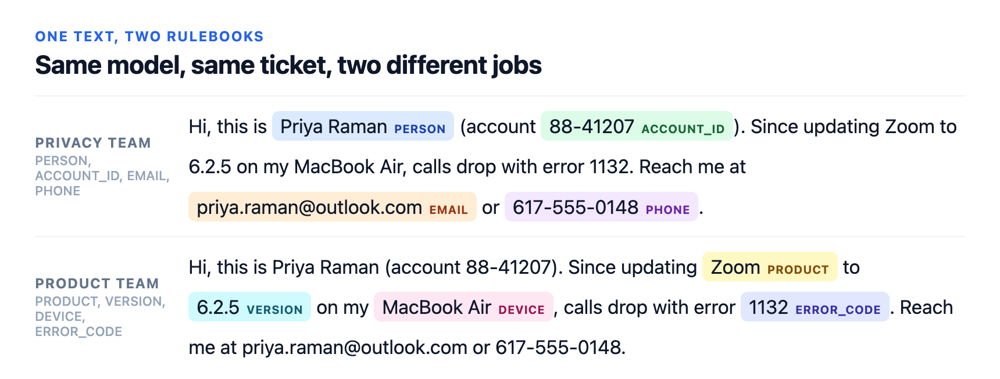
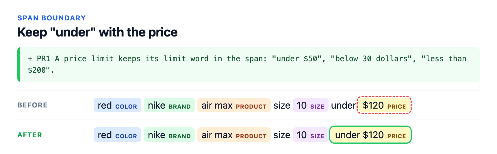
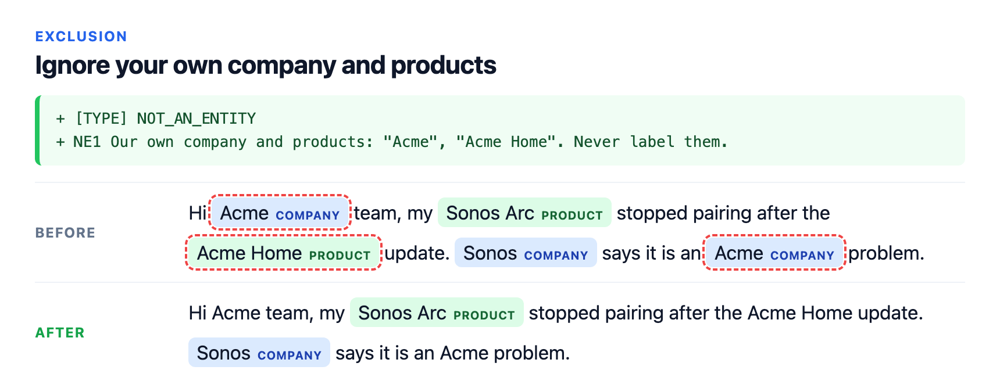
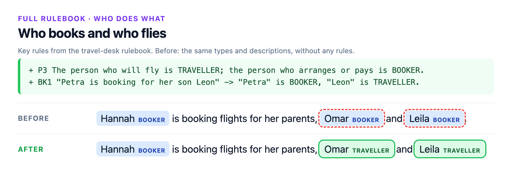
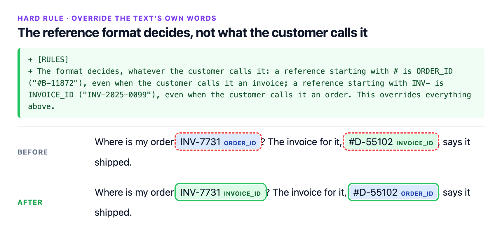
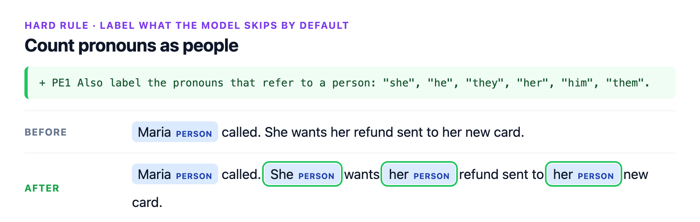
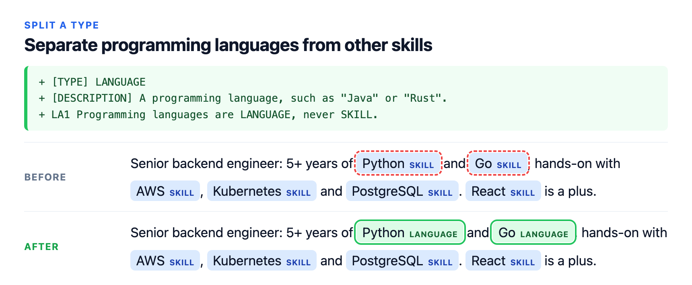
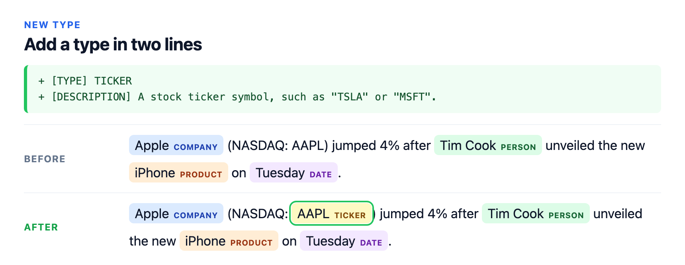
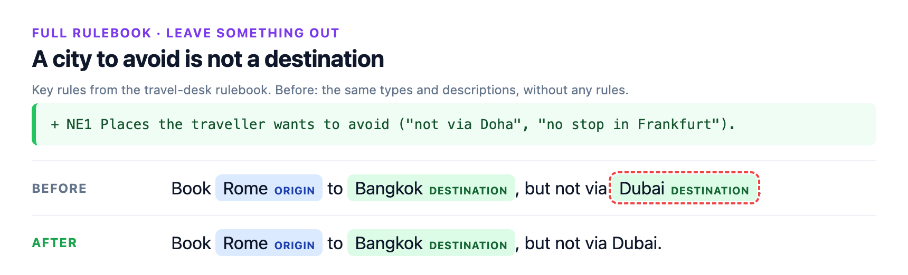
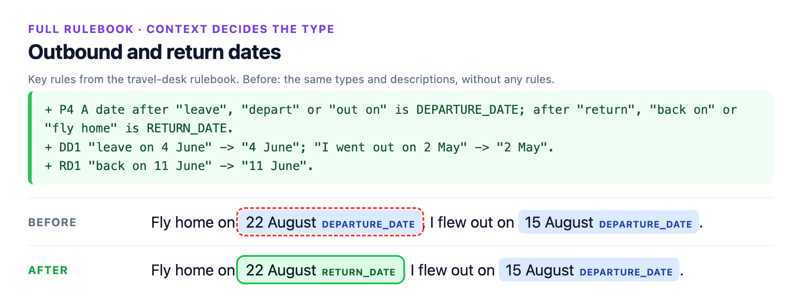

<div align="center">

# ReDefiNER

**Define what to extract. In plain English.**

A generalist 0.8B model for entity extraction and span labeling, guided by the rulebook you write.

**0.8B · Runs on CPU · Extract and label · Rulebooks up to 10k tokens · Apache-2.0**

[](https://github.com/jungroo-ai/redefiner/actions/workflows/ci.yml)

[Quickstart](#quickstart) · [See a rule at work](#see-a-rule-at-work) · [Benchmarks](#benchmarks) · [HTTP server](#http-server) · [Limitations](#limitations) · [Weights](https://huggingface.co/jungroo-ai/redefiner-0.8b) · [Demo](https://huggingface.co/spaces/jungroo-ai/redefiner-demo)

</div>

You describe the entity types you want, in plain English, with any rules about what counts and what doesn't. The model
finds and labels the spans (extract mode), or labels spans you already have (label mode). To change its behaviour, you
change the rulebook, not the weights; nothing is retrained.

<p align="center"></p>

<details>
<summary>Same model, same ticket, two different jobs: the rulebooks and output as text</summary>

**Privacy team**

```text
[RULES]
Extract every entity of the supplied types. Return exact spans from the text.

[TYPE] PERSON
[DESCRIPTION] A person's name.

[TYPE] ACCOUNT_ID
[DESCRIPTION] An account or customer number.

[TYPE] EMAIL
[DESCRIPTION] An email address.

[TYPE] PHONE
[DESCRIPTION] A phone number.
```

Output: Priya Raman `PERSON` · 88-41207 `ACCOUNT_ID` · priya.raman@outlook.com `EMAIL` · 617-555-0148 `PHONE`

**Product team**

```text
[RULES]
Extract every entity of the supplied types. Return exact spans from the text.

[TYPE] PRODUCT
[DESCRIPTION] A named software product or app.

[TYPE] VERSION
[DESCRIPTION] A version number.

[TYPE] DEVICE
[DESCRIPTION] A named hardware model.

[TYPE] ERROR_CODE
[DESCRIPTION] An error code.
```

Output: Zoom `PRODUCT` · 6.2.5 `VERSION` · MacBook Air `DEVICE` · 1132 `ERROR_CODE`

</details>

## At a glance

| | |
|---|---|
| Task | Entity extraction (find and label spans) and span labeling (label spans you supply), in English |
| Control | A plain-English rulebook of types, one-line descriptions and rules; edit it to change the output, with no retraining |
| Output | Spans of your text, each with a type and a confidence; non-generative |
| Benchmarks | 59.8 F1 on the 13 GoLLIE zero-shot NER sets, with GoLLIE's own guidelines (GoLLIE 34B: 58.1); 63.1 on 7 CrossNER and MIT sets with one-line type descriptions (GLiNER large: 61.7, or 62.2 with a dev-tuned threshold). It trails with type names only, on BUSTER and on S1MB labeling: [all results](#benchmarks) |
| Limits | Rulebooks tested up to about 10,000 tokens; text is read 256 tokens at a time (longer texts are split into windows automatically); each span is at most 16 tokens |
| Model size | 0.8B parameters, shipped as one 0.77 GB int8 file |
| Speed, CPU | About 0.4–0.7 s per sentence once the rulebook is loaded (Apple M2, and a 4-core Linux server) |
| Speed, GPU | About 0.05 s per text, or 0.38 s for 16 texts in one call, with a 2,000-token rulebook (NVIDIA A10) |
| Memory, CPU | About 2–2.6 GB at peak, with rulebooks of up to about 1,400 tokens and 16 texts in one call (Apple M2, and a 4-core Linux server) |
| Interfaces | Python (`Tagger.extract`, `Tagger.label`) and a local HTTP server (`redefiner serve`) |
| Licence | Apache-2.0 |
| Release | 1.0 · October 2026 |

## Quickstart

```bash
pip install redefiner
```

Python 3.10 or newer. Runs on CPU, or on an NVIDIA GPU if your PyTorch build has CUDA
([PyTorch's install selector](https://pytorch.org/get-started/locally/) gives the command for your system). On Linux
with a GPU, install `"redefiner[gpu]"` instead: it adds flash-linear-attention's kernels, without which the GPU path is
much slower. On Linux without a GPU, add `--extra-index-url https://download.pytorch.org/whl/cpu` to skip PyTorch's
CUDA build, a download of several GB.

```python
from redefiner import Tagger

tagger = Tagger.from_pretrained("jungroo-ai/redefiner-0.8b")   # GPU if available, else CPU; device="cpu" forces CPU

rulebook = """[RULES]
Extract every entity of the supplied types. Return exact spans from the text.

[TYPE] PERSON
[DESCRIPTION] A person's name.
PE1 Label the full name; leave out titles such as "Dr" or "Prof".

[TYPE] ORGANIZATION
[DESCRIPTION] A company, university or other institution.
"""

tagger.extract("Prof Ada Lovelace corresponded with the Royal Society.", rulebook)
# [{'start': 5, 'end': 17, 'text': 'Ada Lovelace', 'label': 'PERSON', 'confidence': 0.977},
#  {'start': 40, 'end': 53, 'text': 'Royal Society', 'label': 'ORGANIZATION', 'confidence': 0.489}]

# Without rule PE1, the same call keeps the title:
without_pe1 = rulebook.replace('PE1 Label the full name; leave out titles such as "Dr" or "Prof".\n', "")
tagger.extract("Prof Ada Lovelace corresponded with the Royal Society.", without_pe1)
# [{'start': 0, 'end': 17, 'text': 'Prof Ada Lovelace', 'label': 'PERSON', 'confidence': 0.606},
#  {'start': 40, 'end': 53, 'text': 'Royal Society', 'label': 'ORGANIZATION', 'confidence': 0.424}]
```

Each span's `confidence` is its span probability times its type probability. Two settings decide which spans come
back: `threshold` (default 0.5) is the minimum span probability, and `none_bias` (default 2) is subtracted from the
score of "none of these types" before the type is picked, so borderline spans get a type instead of being dropped. The
confidence is computed without that bias, so a returned span can score below 0.5. Above, "Royal Society" is almost
certainly a span (0.997), but the model weighs ORGANIZATION (0.491) and none of the types (0.508) about equally:
0.997 × 0.491 = 0.489. Filter on `confidence` if you only want the spans the model is sure of.

Label mode, when you already have the spans:

```python
text = "Ada Lovelace corresponded with the Royal Society."
tagger.label(text, [(0, 12), (35, 48)], rulebook)
# [{'start': 0, 'end': 12, 'text': 'Ada Lovelace', 'label': 'PERSON', 'confidence': 1.0,
#    'alternatives': [('ORGANIZATION', 0.0)]},
#  {'start': 35, 'end': 48, 'text': 'Royal Society', 'label': 'ORGANIZATION', 'confidence': 0.997,
#    'alternatives': [('PERSON', 0.003)]}]
```

Here `confidence` is the probability of the chosen type among the rulebook's types. Both calls also take a list of texts (and, for `label`, one list of spans per text) and return one result list per text.

**Writing your own rulebook:** start from a [template](docs/templates/) (a blank layout; PII, news, product reviews and scientific text; and a skeleton for types that depend on context), and see [How to write rules that work](docs/writing-rules.md).

## See a rule at work

Every card on this page is real output: the released int8 model on a laptop CPU, with nothing retrained between runs.
Only the rulebook changes. Green lines were added to the rulebook; spans outlined in red disappear, spans outlined
in green are new or changed. [Try your own text and rules in the demo](https://huggingface.co/spaces/jungroo-ai/redefiner-demo).

<p align="center"></p>

<details>
<summary>Keep "under" with the price: the rulebook and output as text</summary>

**Before**

```text
[RULES]
Extract every entity of the supplied types. Return exact spans from the text.

[TYPE] BRAND
[DESCRIPTION] A brand name.

[TYPE] PRODUCT
[DESCRIPTION] A product line or model name.

[TYPE] COLOR
[DESCRIPTION] A colour.

[TYPE] SIZE
[DESCRIPTION] A size.

[TYPE] PRICE
[DESCRIPTION] A price or a price limit.
```

Output: red `COLOR` · nike `BRAND` · air max `PRODUCT` · 10 `SIZE` · $120 `PRICE`

**After**

```text
[RULES]
Extract every entity of the supplied types. Return exact spans from the text.

[TYPE] BRAND
[DESCRIPTION] A brand name.

[TYPE] PRODUCT
[DESCRIPTION] A product line or model name.

[TYPE] COLOR
[DESCRIPTION] A colour.

[TYPE] SIZE
[DESCRIPTION] A size.

[TYPE] PRICE
[DESCRIPTION] A price or a price limit.
PR1 A price limit keeps its limit word in the span: "under $50", "below 30 dollars", "less than $200".
```

Output: red `COLOR` · nike `BRAND` · air max `PRODUCT` · 10 `SIZE` · under $120 `PRICE`

</details>

<p align="center"></p>

<details>
<summary>Ignore your own company and products: the rulebook and output as text</summary>

**Before**

```text
[RULES]
Extract every entity of the supplied types. Return exact spans from the text.

[TYPE] COMPANY
[DESCRIPTION] A company name.

[TYPE] PRODUCT
[DESCRIPTION] A named product or device.
```

Output: Acme `COMPANY` · Sonos Arc `PRODUCT` · Acme Home `PRODUCT` · Sonos `COMPANY` · Acme `COMPANY`

**After**

```text
[RULES]
Extract every entity of the supplied types. Return exact spans from the text.

[TYPE] COMPANY
[DESCRIPTION] A company name.

[TYPE] PRODUCT
[DESCRIPTION] A named product or device.

[TYPE] NOT_AN_ENTITY
NE1 Our own company and products: "Acme", "Acme Home". Never label them.
```

Output: Sonos Arc `PRODUCT` · Sonos `COMPANY`

</details>

The next card uses an example rulebook for a travel desk, with 11 types, written the way the model reads best:
general rules, precedence rules that settle conflicts, numbered type rules with `"query" -> span` examples, and what
never to extract. "Before" is the same rulebook with only its types and descriptions.

<p align="center"></p>

On 21 test queries the full rulebook got 19 exactly right, against 11 with types and descriptions only and 9 with type
names only. Both misses came from one rule: a single code with the wrong name ("my ticket number is ZK48TQ") keeps the
type of its name; the format rule works when both kinds of code appear together.
The layout is explained in [Structure for hard rules](docs/writing-rules.md#7-structure-for-hard-rules), and [`docs/templates/hard-rules.txt`](docs/templates/hard-rules.txt) is a blank copy to fill in.

<details>
<summary>The travel-desk rulebook (<a href="docs/examples/travel-desk-rulebook.txt">docs/examples/travel-desk-rulebook.txt</a>)</summary>

```text
[RULES] Travel desk rulebook. Label each entity in the traveller's message with one of the types below.
G1 Label all entities in the message, not only the first one.
G2 Keep each span as short as the entity itself ("a flight to Oslo" -> "Oslo").
G3 When two types fit, the precedence rules below decide.
[PRECEDENCE]
P1 An airport name or a three-letter airport code is AIRPORT, never ORIGIN or DESTINATION, even after "from" or "to".
P2 Direction decides between ORIGIN and DESTINATION: a place after "from", "out of" or "leaving" is ORIGIN; after "to", "into", "arriving in" or "back to" is DESTINATION.
P3 The person who will fly is TRAVELLER; the person who arranges or pays is BOOKER.
P4 A date after "leave", "depart" or "out on" is DEPARTURE_DATE; after "return", "back on" or "fly home" is RETURN_DATE.
P5 An airline name followed by a programme word ("Miles", "Club", "Rewards") is LOYALTY_PROGRAM; any other airline name is AIRLINE.
P6 The reference format decides, whatever the traveller calls it: a code that mixes letters and digits is BOOKING_REF, even when called a ticket number; a long code of digits only is TICKET_NUMBER, even when called a booking reference.
[TYPE] TRAVELLER
[DESCRIPTION] A person who will take the trip.
TR1 "Book Wanda on the morning flight" -> "Wanda"; "seats for Ilse and Gus" -> "Ilse", "Gus".
[TYPE] BOOKER
[DESCRIPTION] A person who arranges or pays for someone else's trip.
BK1 "Petra is booking for her son Leon" -> "Petra" is BOOKER, "Leon" is TRAVELLER.
BK2 "charge it to Viktor's card" -> "Viktor".
[TYPE] ORIGIN
[DESCRIPTION] The city or country the trip starts from.
OR1 "from Porto" -> "Porto"; "leaving Seoul" -> "Seoul".
[TYPE] DESTINATION
[DESCRIPTION] The city or country the trip goes to.
DS1 "to Nairobi" -> "Nairobi"; "back to Quito" -> "Quito".
[TYPE] AIRPORT
[DESCRIPTION] A named airport or a three-letter airport code.
AI1 "from YYZ" -> "YYZ"; "into Changi" -> "Changi".
[TYPE] DEPARTURE_DATE
[DESCRIPTION] The date the outbound trip starts.
DD1 "leave on 4 June" -> "4 June"; "I went out on 2 May" -> "2 May".
[TYPE] RETURN_DATE
[DESCRIPTION] The date of the return trip.
RD1 "back on 11 June" -> "11 June".
[TYPE] AIRLINE
[DESCRIPTION] An airline the traveller flies with.
AL1 "on Skyvane" -> "Skyvane".
[TYPE] LOYALTY_PROGRAM
[DESCRIPTION] An airline's points or membership programme.
LY1 The span keeps the programme word ("my Skyvane Club number" -> "Skyvane Club").
[TYPE] BOOKING_REF
[DESCRIPTION] A booking reference: a short code of letters and digits.
BR1 "reference QX7PLM" -> "QX7PLM"; "my ticket number is HB2RWA" -> "HB2RWA" is BOOKING_REF.
[TYPE] TICKET_NUMBER
[DESCRIPTION] An e-ticket number: a long code of digits only.
TN1 "ticket 2201234567890" -> "2201234567890"; "booking ref 1259876543210" -> "1259876543210" is TICKET_NUMBER.
[NOT_AN_ENTITY]
NE1 Places the traveller wants to avoid ("not via Doha", "no stop in Frankfurt").
NE2 Request phrases ("can you", "please") and generic words ("flight", "seat", "trip").
```

</details>

<details>
<summary><b>Six more examples</b>: a rule that overrules the words in the text, pronouns, a split type, a new type, and two more travel-desk cards</summary>

**Hard rules.** Rules that overrule the words in the text, or ask for something the model leaves out by default.

<p align="center"></p>

<details>
<summary>The reference format decides, not what the customer calls it: the rulebook and output as text</summary>

**Before**

```text
[RULES]
Extract every entity of the supplied types. Return exact spans from the text.

[TYPE] ORDER_ID
[DESCRIPTION] An order number.

[TYPE] INVOICE_ID
[DESCRIPTION] An invoice number.
```

Output: INV-7731 `ORDER_ID` · #D-55102 `INVOICE_ID`

**After**

```text
[RULES]
Extract every entity of the supplied types. Return exact spans from the text.

[TYPE] ORDER_ID
[DESCRIPTION] An order number.

[TYPE] INVOICE_ID
[DESCRIPTION] An invoice number.
[RULES]
The format decides, whatever the customer calls it: a reference starting with # is ORDER_ID ("#B-11872"), even when the customer calls it an invoice; a reference starting with INV- is INVOICE_ID ("INV-2025-0099"), even when the customer calls it an order. This overrides everything above.
```

Output: INV-7731 `INVOICE_ID` · #D-55102 `ORDER_ID`

</details>

<p align="center"></p>

<details>
<summary>Count pronouns as people: the rulebook and output as text</summary>

**Before**

```text
[RULES]
Extract every entity of the supplied types. Return exact spans from the text.

[TYPE] PERSON
[DESCRIPTION] A person's name.
```

Output: Maria `PERSON`

**After**

```text
[RULES]
Extract every entity of the supplied types. Return exact spans from the text.

[TYPE] PERSON
[DESCRIPTION] A person's name.
PE1 Also label the pronouns that refer to a person: "she", "he", "they", "her", "him", "them".
```

Output: Maria `PERSON` · She `PERSON` · her `PERSON` · her `PERSON`

</details>

**More everyday edits**

<p align="center"></p>

<details>
<summary>Separate programming languages from other skills: the rulebook and output as text</summary>

**Before**

```text
[RULES]
Extract every entity of the supplied types. Return exact spans from the text.

[TYPE] SKILL
[DESCRIPTION] A technical skill: a programming language, framework, platform or tool.
```

Output: Python `SKILL` · Go `SKILL` · AWS `SKILL` · Kubernetes `SKILL` · PostgreSQL `SKILL` · React `SKILL`

**After**

```text
[RULES]
Extract every entity of the supplied types. Return exact spans from the text.

[TYPE] SKILL
[DESCRIPTION] A technical skill: a programming language, framework, platform or tool.

[TYPE] LANGUAGE
[DESCRIPTION] A programming language, such as "Java" or "Rust".
LA1 Programming languages are LANGUAGE, never SKILL.
```

Output: Python `LANGUAGE` · Go `LANGUAGE` · AWS `SKILL` · Kubernetes `SKILL` · PostgreSQL `SKILL` · React `SKILL`

</details>

<p align="center"></p>

<details>
<summary>Add a type in two lines: the rulebook and output as text</summary>

**Before**

```text
[RULES]
Extract every entity of the supplied types. Return exact spans from the text.

[TYPE] COMPANY
[DESCRIPTION] A company name.

[TYPE] PERSON
[DESCRIPTION] A person's name.

[TYPE] PRODUCT
[DESCRIPTION] A product name.

[TYPE] DATE
[DESCRIPTION] A date or day.
```

Output: Apple `COMPANY` · Tim Cook `PERSON` · iPhone `PRODUCT` · Tuesday `DATE`

**After**

```text
[RULES]
Extract every entity of the supplied types. Return exact spans from the text.

[TYPE] COMPANY
[DESCRIPTION] A company name.

[TYPE] PERSON
[DESCRIPTION] A person's name.

[TYPE] PRODUCT
[DESCRIPTION] A product name.

[TYPE] DATE
[DESCRIPTION] A date or day.

[TYPE] TICKER
[DESCRIPTION] A stock ticker symbol, such as "TSLA" or "MSFT".
```

Output: Apple `COMPANY` · AAPL `TICKER` · Tim Cook `PERSON` · iPhone `PRODUCT` · Tuesday `DATE`

</details>

**More from the travel-desk rulebook** (the same rulebook as above)

<p align="center"></p>

<p align="center"></p>

</details>

The quoted examples inside the rules ("under $50", "Java", "TSLA", "#B-11872") are not in the texts: the model
applies the rule, it doesn't copy it. Hard rules work when they are concrete, as here; a rule that asks the model
to judge what didn't happen ("only cities the writer actually visited, not ones they plan to") is not followed
yet. See [Limitations](#limitations). To regenerate the cards, run `scripts/build_rule_cards.py`; it stops if any output
differs from what the cards show.

## Benchmarks

Entity-level F1 (exact boundary and type) unless marked; S1MB is accuracy. Full tables, protocols and caveats are on
the [benchmark page](benchmarks/README.md), with every
rulebook it reports in [`benchmarks/rulebooks/`](benchmarks/rulebooks/).

| Benchmark | Metric | ReDefiNER 0.8B | Comparison |
|---|---|---:|---|
| 13 GoLLIE NER sets, GoLLIE's own guidelines | F1 | **59.8** | GoLLIE 34B 58.1 |
| 7 CrossNER and MIT sets, other instruction-following NER models | F1 | 69.9 | B2NER 20B **72.1**, B2NER 7B 69.8 |
| 13 GoLLIE sets, our rules tuned on dev (not equal-information) | F1 | **67.9** | GoLLIE 34B 58.1 |
| BUSTER, SLIMER's type wording | micro-F1 | 22.1 | SLIMER 7B **45.3**; Liquid AI Policy-Linter 0.2 (our run) |
| BUSTER, our rules tuned on dev | micro-F1 | 35.8 | SLIMER 7B **45.3**; Liquid AI Policy-Linter 2.2 (our run) |
| Open NER, 7 CrossNER and MIT sets, one-line type descriptions | F1 | **63.1** | GLiNER large 61.7, 62.2 with a dev-tuned threshold (our run) |
| Open NER, same sets, type names only | F1 | 56.2 | GNER-T5-large **63.5**; GLiNER large 61.6, 63.1 tuned, and NuNER Zero-span 62.6 (our runs) |
| S1MB span labeling, 2 of its 137 tasks (Few-NERD, Gretel PII) | accuracy | 72.0 | best entry at 1B or less **92.3**; on these two tasks ReDefiNER ranks 87 of 208, 3 of 60 at 1B or less; Liquid AI's d1-2B 74.3 (our run) |

All numbers use one fixed setting (int8, span threshold 0.5, NONE bias 2, 256-token query cap). Baseline numbers are
published results unless marked as our run.

### The 13 GoLLIE zero-shot NER sets, with GoLLIE's own guidelines

GoLLIE's guideline text and five examples per type, converted into a rulebook with nothing added; scored with GoLLIE's
code. ReDefiNER scores are the mean over 3 orders of the types in the rulebook; GoLLIE scores are from its paper.

| Dataset | ReDefiNER 0.8B | GoLLIE 7B | GoLLIE 13B | GoLLIE 34B |
|---|---:|---:|---:|---:|
| FabNER | **32.7** | 24.8 | 25.4 | 26.3 |
| MultiNERD | **82.0** | 76.0 | 77.5 | 77.2 |
| BroadTwitter | 45.5 | 49.5 | **51.4** | 50.3 |
| HarveyNER | 33.5 | 37.3 | **41.3** | 38.9 |
| E3C | 47.7 | 59.0 | 59.0 | **60.0** |
| WikiEvents | 46.4 | 80.7 | 80.2 | **81.3** |
| CrossNER AI | **66.7** | 59.1 | 56.7 | 61.6 |
| CrossNER Literature | **70.1** | 62.7 | 59.7 | 59.1 |
| CrossNER Music | **73.7** | 67.8 | 65.5 | 68.4 |
| CrossNER Politics | **78.0** | 57.2 | 54.4 | 60.2 |
| CrossNER Science | **66.0** | 55.5 | 56.2 | 56.3 |
| MIT Movie | **71.3** | 63.0 | 62.5 | 62.4 |
| MIT Restaurant | **63.8** | 43.4 | 49.8 | 52.7 |
| **Mean, all 13** | **59.8** | 56.6 | 56.9 | 58.1 |

ReDefiNER leads GoLLIE 34B on 9 of the 13 sets with about 1/40 of its parameters. The largest loss is WikiEvents, which
labels pronouns and common nouns under the ACE05 scheme GoLLIE was trained on.

### Open NER: the same 7 CrossNER and MIT test sets

Mean F1 over 6,470 sentences, with each type given as a one-line description or by its name only. For our runs of
other models, the first number uses the model's default threshold and the second a threshold chosen on the dev sets;
ReDefiNER uses its one fixed release setting.

| Model | With descriptions | Names only |
|---|---:|---:|
| ReDefiNER 0.8B | **63.1** | 56.2 |
| GLiNER large v2.5, our run | 61.7 / 62.2 | 61.6 / 63.1 |
| NuNER Zero-span 0.4B, our run | 26.5 / 55.5 | 62.6 / 62.6 |
| NuNER Zero 0.4B, our run | 25.8 / 46.6 | 56.8 / 56.9 |
| Liquid AI Policy-Linter 350M, our run | 47.5 / 48.5 | – |
| GNER-T5-large 0.78B, reported | – | **63.5** |

ReDefiNER leads when types are described, also against the tuned baselines. With names only it trails GLiNER large,
NuNER Zero-span and GNER. Descriptions hurt both NuNER models, which were trained on short type names; their labels are
lower-cased as NuNER's card requires. NuNER Zero's own reported 68.0 on these sets is token-level F1, which gives
credit for partly right spans; scored that way, our run gives 67.9. The Policy-Linter takes free-text rules at
inference, like ReDefiNER, but scores each word on its own, so multi-word names often break apart.

### S1MB span labeling: Few-NERD and Gretel PII

| Model | Params | Few-NERD | Gretel PII | Mean |
|---|---:|---:|---:|---:|
| bekko-system-one-v0-400m, best entry at 1B or less | 0.39B | **89.4** | **95.2** | **92.3** |
| Jev 1.13.0 | not reported | 80.2 | 88.1 | 84.1 |
| Fastino GLiDE (hosted API) | not reported | 83.2 | 74.2 | 78.7 |
| Liquid AI d1-2B, our run | 1.92B | 70.1 | 78.5 | 74.3 |
| ReDefiNER | 0.8B | 71.8 | 72.2 | 72.0 |
| Liquid AI d1-omni-600M, our run | 0.6B | 31.8 | 30.6 | 31.2 |

Accuracy on the benchmark's own cases. Rows not marked "our run" are from the S1MB leaderboard. The d1 decision models got S1MB's records as they are, through their
`system_one` interface. Settings, prompts and every other caveat are on the [benchmark page](benchmarks/README.md).

## Rulebooks

A rulebook has an optional `[RULES]` section with rules for every type, then one `[TYPE]` section per type: a one-line
`[DESCRIPTION]` and any number of rule lines. An optional `[TYPE] NOT_AN_ENTITY` section lists what is never tagged.
The same rulebook can be passed as a dict:

```python
rulebook = {
    "general": ["Extract every entity of the supplied types."],
    "classes": [
        {"name": "PERSON", "description": "A person's name.",
         "rules": ['PE1 Label the full name; leave out titles such as "Dr" or "Prof".']},
        {"name": "ORGANIZATION", "description": "A company, university or other institution."},
    ],
    "never": ["Pronouns."],
}
```

Type names use letters, digits and underscores (`DATE_OF_BIRTH`, not `DATE-OF-BIRTH`), on a line of their own:
`[TYPE] NAME`. A line that starts with `[TYPE]` but is written any other way is an error, so a type is never dropped
silently. To see what was read, `parse(to_text(rulebook))` (both from `redefiner.rulebook`) returns the layout and the
type names, e.g. `("uniform", ["PERSON", "ORGANIZATION"])`.

**Two layouts.** The layout above has `[RULES]` on a line of its own and `[TYPE] NOT_AN_ENTITY` for what is never
tagged. The other, used by [`hard-rules.txt`](docs/templates/hard-rules.txt) and the travel-desk example, has text on
the `[RULES]` line, `[PRECEDENCE]` rules before the types, and a final `[NOT_AN_ENTITY]` section. Use one or the other;
a rulebook that mixes them (a `[RULES]` line of its own and a `[NOT_AN_ENTITY]` section) is an error. Windows line
endings are fine.

Templates to copy are in [`docs/templates/`](docs/templates/).

What works, from the benchmarks (see [How to write rules that work](docs/writing-rules.md)):
- **Descriptions matter.** With a one-line description per type the model scores 7 points higher than with type names
  alone on our open-NER sets; always write them.
- **Boundary, exclusion and convention rules work.** "The span includes the @ of a Twitter handle" took BroadTwitter
  from 45.5 to 70.6 F1. "Never label Houston, Texas or Harvey" cut those false positives from 389 to 5 on HarveyNER.
- **Rules that fight a strong prior don't.** Asking it to label a person's name as something other than a person, or to
  label common nouns as entities, mostly has no effect. Pronouns are the exception: listed under the type, they are
  labelled (the "Count pronouns as people" card above). See [Limitations](#limitations).

## Label mode

`label(text, spans, rulebook, allow_none=False, snap=False)`

- Spans are character offsets into the original text, start inclusive, end exclusive, as `(start, end)` or
  `{"start": .., "end": ..}`.
- Each span gets the best type and its confidence, plus the next two alternatives.
- `allow_none=False` (default) forces a choice among the rulebook's types. `allow_none=True` lets the model answer
  `"NONE"` for a span that isn't any of them.
- A span the model can't read comes back with `"unsupported": reason` instead of a label, never dropped and never
  changed silently:
  - it doesn't start and end on token boundaries ("would be snapped"), e.g. part of a word. Pass `snap=True` to label
    it widened to whole tokens; the result then carries the widened offsets and `"snapped": True`;
  - it is longer than 16 tokens;
  - its offsets are invalid.

## Long texts

The model reads up to 256 tokens of text per pass. Longer texts are split automatically into overlapping windows, cut at
sentence ends where possible:
- in extract mode, where two windows disagree about a span, the one further from a window edge is kept;
- in label mode, each window is placed around the spans it labels.

Each window is read on its own, so the same name can get different labels in different parts of a long document.
If consistency matters, label each distinct string once with `label` and apply the result everywhere.

## Speed

CPU, int8 weights, on CrossNER AI test sentences (about 32 tokens each). A rulebook is encoded with the first text and
then cached (the last 8 rulebooks are kept), so each later text only pays for itself.

Apple M2 (8 cores):

| Rulebook | Tokens | Load the model | First text | Each later text | 16 texts in one call | Peak memory |
|---|---:|---:|---:|---:|---:|---:|
| Quickstart, 2 types | 82 | 2.2 s | 0.7 s | 0.39 s | 4.6 s | 2.0 GB |
| Travel desk, 11 types | 972 | 2.3 s | 3.4 s | 0.71 s | 5.1 s | 2.1 GB |
| GoLLIE MIT Movie, 12 types | 1,376 | 2.3 s | 4.8 s | 0.67 s | 4.9 s | 2.2 GB |

Linux cloud server (Ubuntu 24.04, Intel Xeon 2.3 GHz, 4 cores, no GPU, Python 3.13), measured by a tester:

| Rulebook | Tokens | Load the model | First text | Each later text | 16 texts in one call | Peak memory |
|---|---:|---:|---:|---:|---:|---:|
| Quickstart, 2 types | 62 | 2.0 s | 0.9 s | 0.40 s | 6.8 s | 2.2 GB |
| Travel desk, 11 types | 972 | 1.9 s | 4.5 s | 0.37 s | 6.2 s | 2.6 GB |
| GoLLIE MIT Movie, 12 types | 1,376 | 2.0 s | 5.2 s | 0.37 s | 6.7 s | 2.6 GB |

Peak memory is reached with 16 texts in one call; on the Linux server the process used 1.1 GB right after loading
and 1.4 GB after the first text. Sending texts in one call is faster than one at a time on the M2 and on a GPU, but
saves little on the 4-core server. On CPU the package replaces one slow PyTorch operation (a depthwise convolution
with no MKLDNN fast path) with an exact equivalent; that alone is a 7–14× speedup on Macs.

On one NVIDIA A10 (int8 weights, fp32 compute, flash-linear-attention 0.5.2 installed, as `redefiner[gpu]` does), with a 7,700-character rulebook of 16 types (about 2,000 tokens),
measured through our benchmark server, HTTP included:

| | Seconds |
|---|---:|
| First text after loading a new rulebook | 0.39 |
| Each further text, one at a time | 0.05 |
| 16 texts in one call | 0.38 |

GPU memory use was not measured.

## HTTP server

```bash
redefiner serve --model jungroo-ai/redefiner-0.8b --port 8000
```

It listens on 127.0.0.1 (`--host` to change) and handles one request at a time. Both endpoints take a list of texts
and return one result list per text. The rulebook is text or, as here, the dict form of `to_text`:

```bash
RULEBOOK='{"general": ["Extract every entity of the supplied types. Return exact spans from the text."],
           "classes": [{"name": "PERSON", "description": "The name of a person."},
                       {"name": "ORGANIZATION", "description": "A company, university or other institution."}]}'

curl -s localhost:8000/extract -d "{\"rulebook\": $RULEBOOK, \"texts\": [\"Ada Lovelace corresponded with the Royal Society.\"]}"
# {"results": [[{"start": 0, "end": 12, "text": "Ada Lovelace", "label": "PERSON", "confidence": 0.989},
#               {"start": 35, "end": 48, "text": "Royal Society", "label": "ORGANIZATION", "confidence": 0.431}]], "ms": 2101}

curl -s localhost:8000/label -d "{\"rulebook\": $RULEBOOK, \"texts\": [\"Ada Lovelace corresponded with the Royal Society.\"], \"spans\": [[[0, 12], [35, 48]]]}"
# {"results": [[{"start": 0, "end": 12, "text": "Ada Lovelace", "label": "PERSON", "confidence": 0.999, "alternatives": [["ORGANIZATION", 0.001]]},
#               {"start": 35, "end": 48, "text": "Royal Society", "label": "ORGANIZATION", "confidence": 0.994, "alternatives": [["PERSON", 0.006]]}]], "ms": 302}
```

| Endpoint | Fields | Optional fields (default) |
|---|---|---|
| `POST /extract` | `rulebook`, `texts` | `threshold` (0.5), `none_bias` (2) |
| `POST /label` | `rulebook`, `texts`, `spans`: one list of `[start, end]` per text | `allow_none` (false), `snap` (false), `none_bias` (2) |
| `GET /info` | | |

A span that can't be labelled comes back with an `unsupported` reason in place of a label (see
[Label mode](#label-mode)). A malformed request gets HTTP 400 and an `error` message.

The server has no authentication and no limit on request size. Keep it on 127.0.0.1, or put it behind your own proxy
if it has to be reachable from other machines.

## Limitations

- **Rules against a strong prior are mostly ignored.** Relabelling a person's name as something other than a person,
  asking for common nouns as entities, or "only revenue amounts, not every money amount" mostly has no effect.
  Pronouns do work when they are quoted in a short list under the type.
- **Types that depend on context need structure.** Precedence rules and numbered rules with worked examples help (see [Structure for hard rules](docs/writing-rules.md#7-structure-for-hard-rules)); rules that need counting or judging what didn't happen are still mostly ignored.
- **Names-only rulebooks are weaker** than descriptive ones; always write a one-line description per type.
- **Abstaining is weak.** When a type's condition isn't clearly met, the model tends to label anyway.
- **Spans up to 16 tokens**; text is read 256 tokens at a time, and longer texts are split into overlapping windows.
- English only; tested on English benchmarks only.

## Intended use

ReDefiNER is meant for extracting entities from English text when you need control over what counts: your own entity
types, document fields, search-query slots, and research on rule-following extraction.

- **Check outputs before acting on them** in legal, medical, financial or other high-stakes work. The model can miss or
  mislabel spans, and its confidences are model scores, not guarantees.
- **Don't rely on it as the only safeguard** when finding personal data for redaction or compliance; it will miss some.
- **Don't use it to profile or track people** without a legal basis and their consent.

<details>
<summary><strong>Architecture</strong></summary>

| Component | Description |
|---|---|
| Backbone | [Qwen3.5-0.8B](https://huggingface.co/Qwen/Qwen3.5-0.8B): 24 layers (18 linear-attention, 6 full-attention), hidden size 1,024. LoRA of rank 32 on the attention and MLP projections, merged into the weights |
| Rulebook encoding | The rulebook runs once through the backbone, with a marker after each type's section. Its states are cached, so each new text costs only the text |
| Span head | Scores every span of up to 16 tokens from its start and end states and a width embedding |
| Label head | Matches each span against the marker vectors of the rulebook's types, plus a learned "none" |
| Weights | int8 weight-only, with one fp32 scale per output channel; fp32 compute |
| Rulebook length | Works with rulebooks of up to about 10,000 tokens, the longest in our internal tests; the public benchmark rulebooks go up to about 2,000. Longer rulebooks fit in Qwen3.5's 262,144-token context but are untested. The rulebook is encoded in 1,024-token chunks, so memory does not grow with the square of its length; a long one takes longer to encode the first time and uses more memory |
| Text window | Texts are read 256 tokens per pass, the length the model was trained and tested on; longer texts are split into overlapping windows automatically. The pass length can be raised (`max_query_tokens`), but that is untested |

</details>

## Repository

| Path | What it holds |
|---|---|
| `src/redefiner/` | The package: `Tagger` (`api.py`), the model (`model.py`), the rulebook format (`rulebook.py`), long-text windows (`windows.py`), the HTTP server (`serve.py`) and the int8 export (`export.py`) |
| `benchmarks/` | The [benchmark page](benchmarks/README.md), every rulebook it reports, and `reproduce/` to rerun one number per mode on your machine |
| `docs/` | [How to write rules that work](docs/writing-rules.md), [rulebook templates](docs/templates/), the example travel-desk rulebook, and the images in "See a rule at work" |
| `space/` | The demo app (Gradio) |
| `scripts/` | The weight export, and the scripts that build the demo's stored outputs ([details](scripts/README.md)) |
| `tests/` | Unit tests, and end-to-end tests that run when the weights are in `weights/` |

## Development

```bash
git clone https://github.com/jungroo-ai/redefiner && cd redefiner
pip install -e ".[dev]"
hf download jungroo-ai/redefiner-0.8b --local-dir weights   # optional: enables the end-to-end tests
pytest
ruff check .
```

To check a published number on your hardware: `python benchmarks/reproduce/reproduce.py --model weights` (CrossNER AI
for extract mode, S1MB Few-NERD for label mode, each compared with the A10 run).

## Licence

Apache-2.0, for the code and the weights. The weights are a modified version of Qwen3.5-0.8B (Apache-2.0); `NOTICE`
in the model repo lists the modifications. The GoLLIE guideline text in
`benchmarks/` comes from [GoLLIE](https://github.com/hitz-zentroa/GoLLIE) (Apache-2.0). The benchmark datasets keep
their own licences: test sentences and quoted examples from them (in `benchmarks/` and the demo) are covered by those
licences, not by Apache-2.0; see [Datasets and licences](benchmarks/README.md#datasets-and-licences).

## Citation

```bibtex
@misc{redefiner2026,
  title  = {ReDefiNER: Rule-Defined Named Entity Recognition},
  author = {{Jungroo AI Labs}},
  year   = {2026},
  url    = {https://huggingface.co/jungroo-ai/redefiner-0.8b},
  note   = {Release 1.0}
}
```

## Credits

Created by [Jungroo AI Labs](https://huggingface.co/jungroo-ai).
